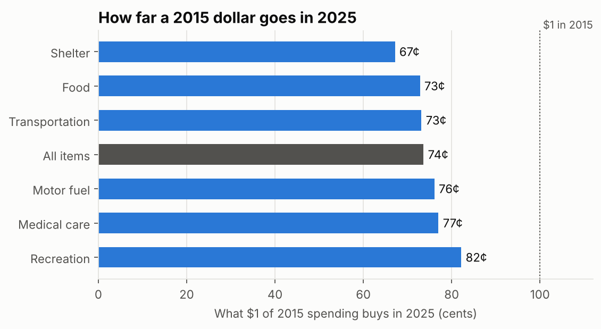
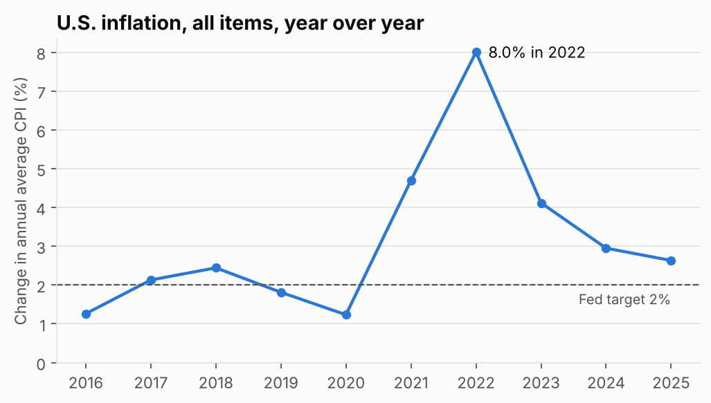
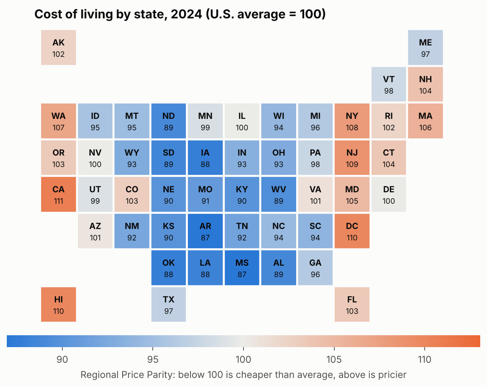
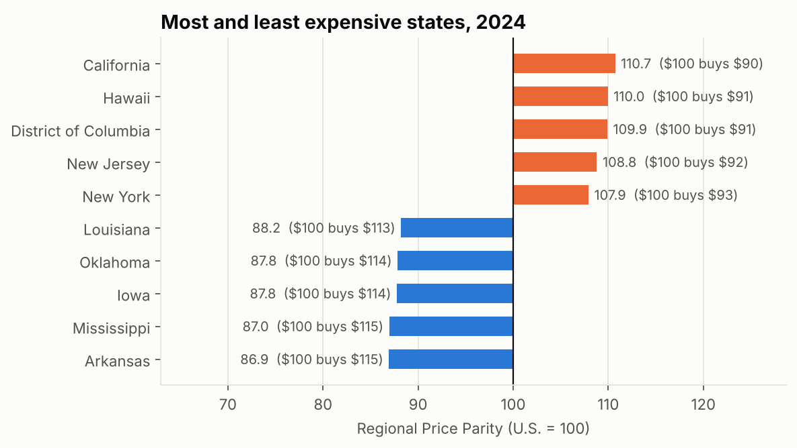

# Results

_Generated by `python -m money` from the data in `data/raw/`. Do not edit by hand._

## How far a 2015 dollar goes in 2025

| Category | Prices up | $1 of 2015 spending buys in 2025 |
|---|---|---|
| Shelter | 48.9% | 67¢ |
| Food | 37.3% | 73¢ |
| Transportation | 36.7% | 73¢ |
| All items | 35.8% | 74¢ |
| Motor fuel | 31.4% | 76¢ |
| Medical care | 29.8% | 77¢ |
| Recreation | 21.7% | 82¢ |

A basket that cost $100 in 2015 costs $135.83 in 2025.

## Inflation year over year

Inflation peaked at 8.0% in 2022. It was above the Fed's 2% target in 7 of 10 years (2017, 2018, 2021, 2022, 2023, 2024, 2025).

Note: annual averages for 2025 use fewer than 12 months, because BLS published no data for some months (see `tables/cpi_annual.csv`, column `months`).

## Cost of living by state, 2024

Most expensive: California (110.7), Hawaii (110.0), District of Columbia (109.9). Least expensive: Iowa (87.8), Mississippi (87.0), Arkansas (86.9). The gap between the most and least expensive is 23.8 points.
